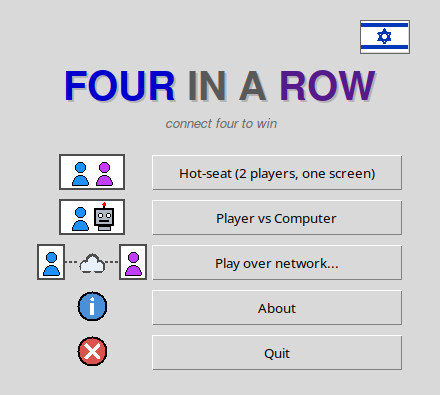
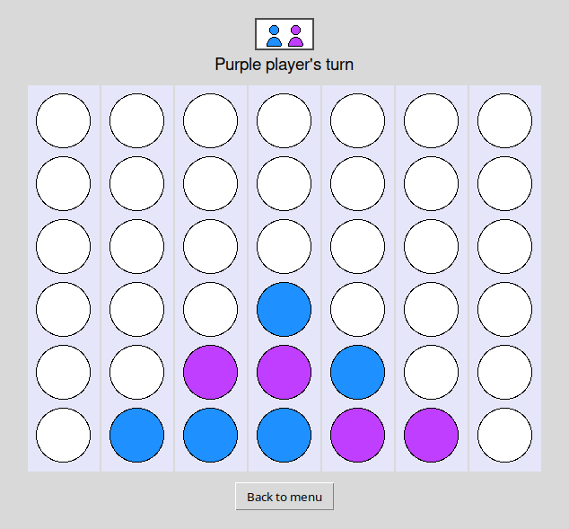

# Four in a Row

A desktop Four in a Row (Connect Four) game written in Python with tkinter.
Pick a mode from the main menu and play.

## Modes

- **Hot-seat** – two players share one screen.
- **Player vs Computer** – play against a simple AI (takes a win, blocks your
  win, otherwise plays randomly).
- **Play over network**
  - **Host** – choose a port and get an `ip:port` to give to the other player.
  - **Join** – enter the host's IP and port to connect to their game.

Who starts is chosen at random. The whole UI can be switched between
**English and Hebrew** (עברית) with the button at the top of the menu (it opens in Hebrew), and
there is an About page with the project credits.

## Screenshots





## Run

Requires Python 3.8+ with tkinter (no other dependencies).

```bash
# with uv (recommended)
uv run four-in-a-row

# or install it with pip and run the command
pip install .
four-in-a-row
```

On Debian/Ubuntu, if tkinter is missing: `sudo apt install python3-tk`.

### Playing over a network

1. One player picks **Play over network → Host a game** and shares the shown
   `ip:port`.
2. The other player picks **Join a game** and enters it.

Both machines must be able to reach each other (same LAN, or a forwarded port
on the host's router). To try it on one computer, run the game twice and join
`127.0.0.1`.

### Command line

```
$ uv run four-in-a-row --help
usage: four-in-a-row [-h] [--lang {he,en}] COMMAND ...

Four in a Row. Run without a command to open the main menu.

positional arguments:
  COMMAND
    hotseat            two players on one screen
    vs-robot (vs_robot)
                       play against the computer
    host               host a network game and show ip:port
    join               join another player's network game
    about (info)       print information about the project

options:
  -h, --help           show this help message and exit
  --lang {he,en}       interface language (default: he)

legacy form still supported: four-in-a-row human|ai PORT [HOST_IP]
```

## Project layout

```
src/four_in_a_row/
├── cli.py            entry point: command line parsing, opens the menu
├── menu.py           main menu, host/join screens, about page, icons
├── i18n.py           English / Hebrew texts (right-to-left reordering for Tk)
├── game.py           game logic and turn handling
├── board.py          board state, win and draw detection
├── gui.py            board drawing and mouse input
├── ai.py             computer opponent
├── communicator.py   non-blocking socket communication
├── config.py         constants
└── assets/           HUJI logo used on the About page
docs/                 screenshots and the original logo
tests/                helper scripts
pyproject.toml        project metadata and the four-in-a-row command
```

## Credits

Made by Meir Weizmann and Yoav Kostiner as a final project in
"Intro to CS" at the HUJI, 2017.

## License

[MIT](LICENSE). The HUJI logo on the About page belongs to the Hebrew University of Jerusalem and is not covered by this license.
